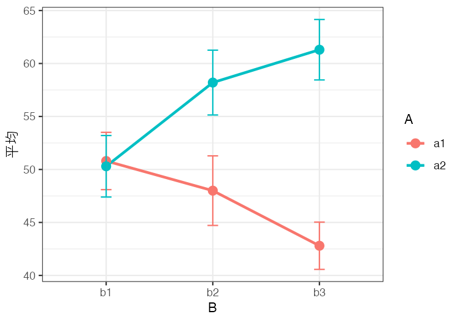

## なにをするものか

分散分析の授業をしていると，「Aの主効果はあるけれど，Bの主効果と交互作用はない」といった，結果の形が決まった例題のデータが欲しくなります。乱数でそれらしいデータを作っても，たまたま有意にならなかったり，入れたつもりのない効果が有意になったりして，思いどおりの例題になかなか仕上がりません。

そこで，計画の型と効果の有無を指定すると，そのとおりの結果になる仮想データを作る関数をまとめました。もとは授業の例題を作るために書き散らしていたスクリプトで，それを関数の形に整え直したものです。

- 計画の型は ANOVA君(anovakun)の書き方(`"As"`，`"sAB"`，`"AsB"` など)で指定します。3要因まで，群間・群内・混合計画のいずれにも対応しています。
- 各効果を `TRUE`/`FALSE` で指定し，効果の大きさも決められます。
- `match = TRUE` とすると，指定した効果だけが有意になり，それ以外は有意にならないデータになるまで乱数の種を探します。

## 入手と読み込み

ファイルは [ANOVA_dataMaker.R](ANOVA_dataMaker.R) からダウンロードできます。インターネットにつながっていれば，次のように直接読み込むこともできます。

```r
source("https://kosugitti.github.io/notes/ANOVA_dataMaker.R")
```

内部で `pacman`，`dplyr`，`tidyr` を使います。`pacman` が入っていなければ，先に `install.packages("pacman")` としておいてください。

## 使い方

### データをつくる

たとえば，Aが群間要因(2水準)，Bが群内要因(3水準)の混合計画で，各群10人，Aの主効果と交互作用があり，Bの主効果はないデータを作るには，次のようにします。

```r
dat <- make_anova_data("AsB", n = 10, levels = c(2, 3),
                       A = TRUE, B = FALSE, AB = TRUE,
                       match = TRUE, seed = 1)
head(dat)
```

```
  id  A  B value
1  1 a1 b1    52
2  1 a1 b2    47
3  1 a1 b3    38
4  2 a1 b1    37
5  2 a1 b2    52
6  2 a1 b3    43
```

1行に1つの測定値が入った縦長の形で返ってきます。このまま `ggplot2` で図にしたり，`aov` や `afex` で分析したりできます。指定していない効果(ここでは `B`)は `FALSE` が既定なので，書かなくてもかまいません。

使った乱数の種は，データに属性として記録されています。授業資料にこの種を書いておけば，同じデータを作り直せます。

```r
attr(dat, "seed")
```

```
[1] 1
```

### 効果を確かめる

`anova_check()` は，`aov` で分散分析をして各効果の $p$ 値を返します。

```r
anova_check(dat)
```

```
           A            B           AB
0.0090862252 0.4877032876 0.0003262894
```

Aの主効果と交互作用だけが有意で，Bの主効果は有意でない，という指定どおりのデータになっています。図にすると，交互作用の形がよくわかります。



### ANOVA君に渡す

`format = "wide"` とするか，縦長のデータを `to_wide()` に通すと，1行に1人の横長の形になります。これはANOVA君にそのまま渡せる形です。

```r
wide <- to_wide(dat)
head(wide, 3)
```

```
  id  A b1 b2 b3
1  1 a1 52 47 38
2  2 a1 37 52 43
3  3 a1 43 30 33
```

```r
anovakun(wide[, -1], "AsB", 2, 3)
```

1列目の `id` を除いて渡すところに注意してください。群内要因が2つ以上あるときは，列名が `a1_b1`，`a1_b2`，… のようになり，最後の要因がいちばん速く変わる順に並びます。これもANOVA君が想定している並びです。

### afex で分析する

縦長のデータは，`afex` の `aov_ez()` にもそのまま渡せます。

```r
library(afex)
fit <- aov_ez(id = "id", dv = "value", data = dat,
              between = "A", within = "B")
fit
```

```
Anova Table (Type 3 tests)

Response: value
  Effect          df    MSE         F  ges p.value
1      A       1, 18 155.15   8.54 ** .231    .009
2      B 1.91, 34.40  46.93      0.73 .015    .482
3    A:B 1.91, 34.40  46.93 10.12 *** .171   <.001
```

### 3要因の場合

3要因でも書き方は同じです。効果の大きさは `TRUE` の代わりに数値で指定することもできます。次の例は，Cの主効果と，大きさ1.5の三次の交互作用だけがある3要因群間計画のデータです。

```r
d3 <- make_anova_data("ABCs", n = 8, C = TRUE, ABC = 1.5,
                      match = TRUE, seed = 1)
round(anova_check(d3), 3)
```

```
    A     B     C    AB    AC    BC   ABC
0.696 0.444 0.000 0.716 0.777 0.638 0.000
```

## 引数

`make_anova_data()` の引数は次のとおりです(カッコ内は既定値)。

| 引数 | 意味 |
|---|---|
| `design` | ANOVA君の型指定。`s` の左が群間要因，右が群内要因。要因は A〜C の3つまで。例: `"As"`，`"sA"`，`"ABs"`，`"AsB"`，`"sAB"`，`"ABCs"`，`"ABsC"`，`"AsBC"`，`"sABC"` |
| `n` | 群間の各セルの参加者数。群間要因がない計画では全体の参加者数 (10) |
| `levels` | 各要因の水準数を A, B, C の順に並べたベクトル (すべて2水準) |
| `A`, `B`, `C` | 主効果の有無。`TRUE` なら `es` の大きさの効果を入れる。数値を書けばその大きさになる (`FALSE`) |
| `AB`, `AC`, `BC`, `ABC` | 交互作用の有無。書き方は主効果と同じ (`FALSE`) |
| `es` | `TRUE` と書いた効果の大きさ。標準偏差 `sigma` を単位とする (0.8) |
| `mu` | 全体平均 (50) |
| `sigma` | 各測定値の標準偏差 (10) |
| `rho` | 群内要因の測定値どうしの相関。大きいほど個人差が大きい (0.5) |
| `digits` | 測定値を丸める小数点以下の桁数。0 なら整数 (0) |
| `format` | `"long"` は1行1測定値，`"wide"` は1行1人でANOVA君向き (`"long"`) |
| `match` | `TRUE` なら，指定した効果だけが有意になるまで乱数の種を変える (`FALSE`) |
| `alpha` | `match = TRUE` のときの有意水準 (0.05) |
| `max_try` | `match = TRUE` のときに種を試す回数の上限 (1000) |
| `seed` | 乱数の種。`match = TRUE` のときは探し始める種 (`NULL`) |

## 効果の入れ方

データは「全体平均 + 効果 + 個人差 + 誤差」として作っています。

- 主効果は，両端の水準の平均値の差が `es × sigma` になるように入れます。3水準以上のときは等間隔に並びます。
- 交互作用は交差型で入れます。2×2 なら，一方の要因の単純効果が，もう一方の要因の水準によって `+es × sigma` と `-es × sigma` に分かれる形です。3水準以上の要因どうしでは「線形×線形」の形になるので，真ん中の水準には交互作用の効果が乗りません。
- 群内要因があるときは，参加者ごとの個人差を加えています。同じ参加者の測定値どうしの相関は `rho` になり，どの水準の組でも同じです。

## 注意

- 個人差は「どの水準の組でも相関が同じ」という形で作っているので，球面性の仮定はほぼ満たされます。球面性が破れたデータを作ることはできません。球面性の検定や補正を説明する例題には向きません。
- `match = TRUE` は，補正をかけない `aov` の $p$ 値で判定しています。ANOVA君や `afex` で Greenhouse-Geisser の補正をかけると，境目付近の効果では判定が変わることがあります。
- 効果を小さくしたり人数を少なくしたりすると，条件に合うデータが見つからないことがあります。そのときは `n` や `es` を大きくしてください。
- 作られるのはあくまで仮想データです。実際の研究のデータとして使うことはできません。
